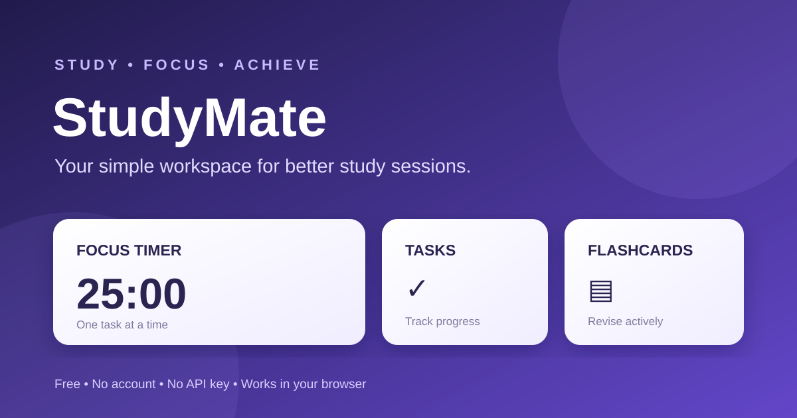

# StudyMate 🎓

**A simple, free study workspace for students. Focus better, organise tasks, and revise with flashcards.**

[🌐 Open StudyMate](https://guellilahmed385-design.github.io/student/) · [📖 Quick guide](docs/guide.md) · [💡 Send feedback](https://github.com/guellilahmed385-design/student/issues/new/choose)

## What you can do
- **Pomodoro timer:** 25-minute focus sessions, 5-minute short breaks, and 15-minute long breaks.
- **Task manager:** add tasks, mark them complete, and track daily progress.
- **Flashcards:** create question-and-answer cards and revise with active recall.
- **Simple statistics:** see your completed focus sessions, tasks, and flashcards.

## Get started
1. Open the [StudyMate website](https://guellilahmed385-design.github.io/student/).
2. Start a focus session or add your study tasks.
3. Create flashcards from your lessons and use them for revision.
4. Your progress is saved locally in the browser on the device you use.

You can also download this repository and open `index.html` directly. No installation, account, API key, or AI service is required.

## Privacy
StudyMate stores tasks, flashcards, and focus-session counts in your browser's local storage. The project does not need an account or send this study data to a server. Clearing browser data may erase saved progress. If you use a different browser or device, your data will not automatically sync.

## Help improve StudyMate
Found a bug or have an idea? [Open a feedback issue](https://github.com/guellilahmed385-design/student/issues/new/choose).

## License
MIT — see [LICENSE](LICENSE).
